# PCBuddy – Desk-Companion für ESP32-C3 SuperMini

<p align="center">
  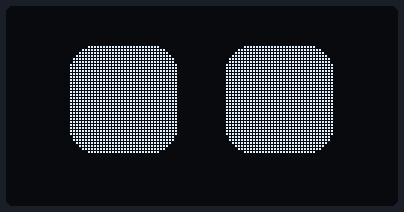
</p>

**PCBuddy** ist ein kleiner Schreibtisch-Begleiter mit animierten OLED-Augen. Er reagiert auf Berührung, Schütteln und
Schaukeln, zeigt Uhrzeit (im Pac-Man-Stil), Wetter und Nachrichten und lässt sich komplett über eine Web-Oberfläche im
Heimnetz steuern. Auch Firmware-Updates gehen per WLAN.

- **Board:** ESP32-C3 SuperMini
- **Display:** 0,96" OLED SSD1306 **oder** 1,3" OLED SH1106 (128×64, I²C), umschaltbar ohne neu zu kompilieren
- **Sprache der Oberfläche:** Deutsch

---

## Inhalt

- [Funktionen](#funktionen)
- [Bilder](#bilder)
- [Teileliste](#teileliste)
- [Verdrahtung](#verdrahtung)
- [Installation](#installation)
- [Ersteinrichtung](#ersteinrichtung)
- [Bedienung am Gerät](#bedienung-am-gerät)
- [Web-Dashboard](#web-dashboard)
- [Firmware-Update per WLAN](#firmware-update-per-wlan)
- [Steuerung per HTTP-API und USB](#steuerung-per-http-api-und-usb)
- [Fehlersuche](#fehlersuche)
- [Projektaufbau](#projektaufbau)
- [Änderungen](#änderungen) · [Lizenz](#lizenz)

---

## Funktionen

| Bereich | Was PCBuddy kann |
|---|---|
| **Gesicht** | 21 animierte Emotionen mit Blinzeln und Umherschauen, z. B. lachen, pochendes Herz, Sternaugen, schwindelig, wütend mit Feuer, „Uh“ |
| **Auto-Wechsel** | Emotionen laufen von selbst durch, als Durchlauf oder ab und zu im Leerlauf. Welche dabei sind, ist wählbar. |
| **Touch** | Tippen, Doppeltipp, 3× Tippen, langes Drücken (TTP223) |
| **Bewegung** | Schütteln macht ihn wütend, langsames Schaukeln gibt ein „Uh“-Gesicht, lange schaukeln macht ihn schwindelig |
| **Pac-Man-Uhr** | Ziffern aus Pellets. Pac-Man frisst kurz vor jedem Minutenwechsel genau die Ziffer, die sich ändert. |
| **Info-Folien** | Wetter (Open-Meteo, ohne API-Key), Uhr, WLAN, IP-Adresse, Firmware |
| **Text** | Lauftext (Geschwindigkeit 1–10) oder stehender Text, mit Umlauten, ß, €, ° |
| **Ruhemodus** | nach Zeitplan oder per 3× Tippen: gedimmt, ohne Ton, mit Schlafgesicht, Uhr oder Display aus |
| **Web-Dashboard** | alles einstellbar im Browser, in Tabs aufgeteilt, fürs Handy optimiert |
| **Update per WLAN** | `.bin`-Datei im Dashboard hochladen oder per Arduino IDE über das Netzwerk |
| **Stabil** | WLAN-Wächter mit automatischer Neuverbindung, Selbstheilung des 1,3"-Displays |
| **API** | jede Aktion per HTTP oder USB-Seriell, z. B. für Skripte, Stream Deck oder Home Assistant |

---

## Bilder

> Alle Bilder wurden aus der echten Firmware erzeugt (simulierter Bildspeicher, 1:1 die gleichen Pixel wie auf dem OLED).

### Pac-Man-Uhr
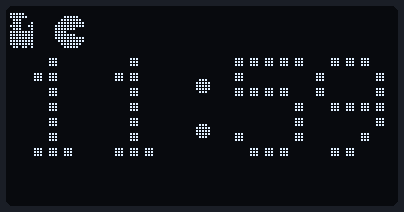

Pac-Man läuft mit dem Geist auf einem Rundkurs über und unter den Ziffern, ohne sie zu berühren. **Erst 1–3 Sekunden vor
dem Minutenwechsel** geht er in die Ziffern, die sich gleich ändern, und frisst sie. **Genau zur vollen Minute** erscheint
die neue Zahl. Optional gibt es dazu „Waka-Waka“, aber nur zur vollen Stunde.

### Alle 21 Emotionen
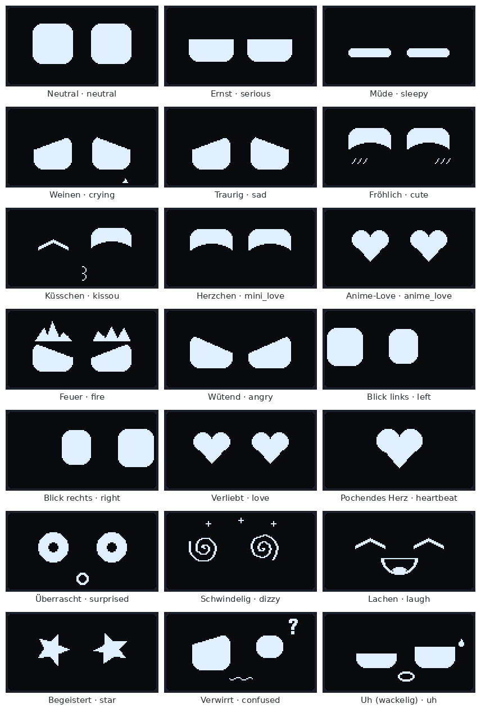

### Info-Folien, Text und Sensoren
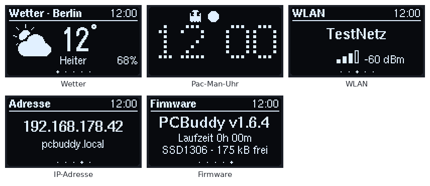
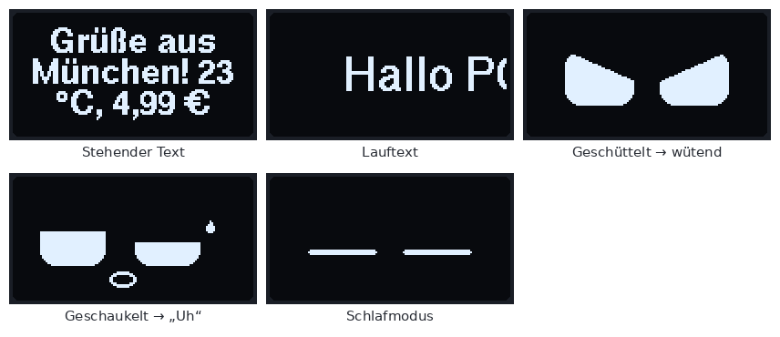

### Web-Dashboard
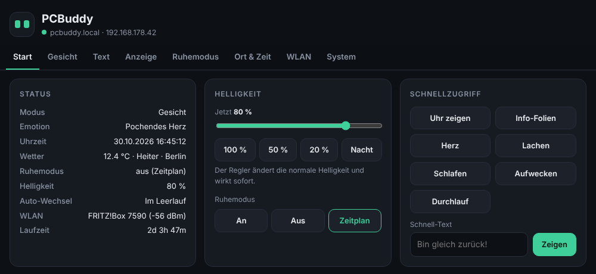

<p>
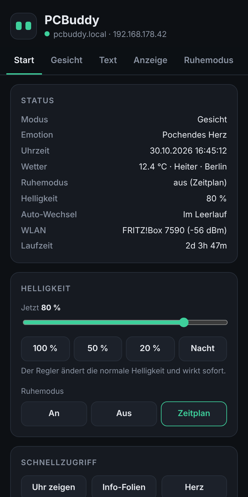
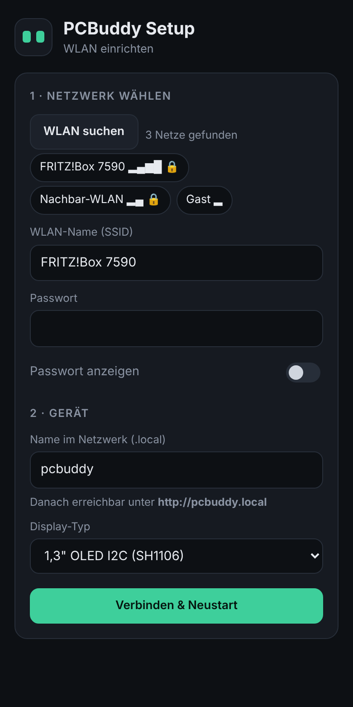
</p>

---

## Teileliste

| Teil | Hinweis |
|---|---|
| ESP32-C3 SuperMini | mit USB-C, 4 MB Flash |
| OLED 128×64 I²C | 0,96" (SSD1306) **oder** 1,3" (SH1106) |
| TTP223 Touch-Sensor | kleines Modul mit Digitalausgang |
| Passiver Piezo-Buzzer | **passiv**, kein aktiver Summer |
| Vibrationsmotor | Münzmotor, **über Transistor** (z. B. 2N2222 + 1 kΩ + Diode 1N4148) oder fertiges Modul |
| Neigungssensor | SW-520D (Kugel) oder besser SW-18010P (Feder). KY-020/SW-420-Module gehen auch. |
| optional | 100 Ω für den Buzzer, 100 µF + 100 nF am Display (empfohlen beim 1,3") |

Buzzer, Motor und Neigungssensor sind optional. In `config.h` auf `-1` setzen, wenn sie fehlen.

---

## Verdrahtung

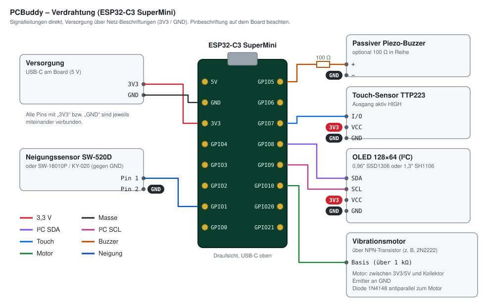

| Bauteil | Pin am Bauteil | ESP32-C3 SuperMini |
|---|---|---|
| OLED (beide Typen) | VCC / GND | 3V3 / GND |
| | SDA | **GPIO 8** |
| | SCL | **GPIO 9** |
| Touch TTP223 | VCC / GND | 3V3 / GND |
| | I/O | **GPIO 7** |
| Passiver Buzzer | + / − | **GPIO 5** / GND |
| Vibrationsmotor | über NPN-Transistor | **GPIO 10** → 1 kΩ → Basis |
| Neigungssensor | Pin 1 / Pin 2 | **GPIO 1** / GND (interner Pull-up, kein Widerstand nötig) |

> [!WARNING]
> - Den **Vibrationsmotor nie direkt** an einen GPIO hängen, sondern über einen Transistor mit Freilaufdiode.
> - Bei manchen 1,3"-Modulen sind **VCC und GND vertauscht** beschriftet. Vor dem Anschließen prüfen!

**Tipps zum Aufbau**
- **SW-520D senkrecht einbauen** (Beinchen nach unten). Er schaltet erst ab etwa 30–45° Neigung. Liegt er flach,
  klappert er ständig oder schaltet nie. Prüfen lässt sich das live unter *Dashboard → Anzeige → Sensor-Test*.
- **1,3"-Display (SH1106):** Es reagiert empfindlich auf Spannungseinbrüche durch Buzzer und Motor. Die Firmware stellt es
  automatisch wieder her. Noch besser ist zusätzlich ein 100-Ω-Widerstand vor dem Buzzer, ein Kondensator am Display, und
  das Display an 5V statt 3V3, wenn das Modul einen eigenen Spannungsregler hat.

Alle Pins und Zeiten lassen sich in [`PCBuddy/config.h`](PCBuddy/config.h) ändern.

---

## Installation

### Arduino IDE (2.x)

1. **Boardverwalter:** „esp32“ von Espressif, Version **3.x** installieren
2. **Bibliotheksverwalter:** **U8g2** (von oliver) installieren
3. Dieses Repository herunterladen (*Code → Download ZIP*) und **`PCBuddy/PCBuddy.ino`** öffnen
4. Unter **Werkzeuge** einstellen:

   | Einstellung | Wert |
   |---|---|
   | Board | **ESP32C3 Dev Module** |
   | USB CDC On Boot | **Enabled** |
   | Partition Scheme | **Minimal SPIFFS (1.9MB APP with OTA/128KB SPIFFS)** |
   | Flash Size | 4MB |

5. Per USB hochladen. Klappt das nicht: **BOOT** gedrückt halten, kurz **RESET**, BOOT loslassen.

> [!IMPORTANT]
> Nimm als Board **„ESP32C3 Dev Module“**, nicht „Nologo ESP32C3 Super Mini“. Der Nologo-Eintrag bietet das
> Partitionsschema mit Update-Bereich nicht an, und ohne dieses Schema funktionieren Updates per WLAN nicht.

### Schon installiert? → Update per WLAN

Läuft PCBuddy bereits mit dem richtigen Partitionsschema, lade einfach die Datei `PCBuddy_update_vX.Y.Z.bin` aus den
[**Releases**](../../releases) im Dashboard hoch (siehe [Firmware-Update per WLAN](#firmware-update-per-wlan)).

---

## Ersteinrichtung

1. Beim ersten Start öffnet PCBuddy das WLAN **`PCBuddy-Setup`**.
2. Mit dem Handy oder PC verbinden. Die Setup-Seite öffnet sich meist von selbst, sonst **http://192.168.4.1** aufrufen.
3. Heim-WLAN wählen, Passwort, Gerätename (z. B. `pcbuddy`) und **Display-Typ** (0,96" oder 1,3") eintragen → *Verbinden*.
4. PCBuddy startet neu und zeigt seine IP-Adresse. Das Dashboard ist dann erreichbar unter **http://pcbuddy.local**
   (oder unter der IP).

Später lässt sich das Setup jederzeit wieder öffnen: **5 Sekunden auf den Touch-Sensor halten**.

---

## Bedienung am Gerät

| Geste | im Gesicht | auf Info-Folien | auf der Uhr / im Schlaf |
|---|---|---|---|
| **Tippen** | zufällige Reaktion | nächste Folie | Uhr: bleibt · Schlaf: aufwecken |
| **Doppeltipp** | Info-Folien öffnen | zurück zum Gesicht | zurück zum Gesicht |
| **3× tippen** | Ruhemodus an/aus | Ruhemodus an/aus | Ruhemodus an/aus |
| **Lang drücken** (0,65 s) | verliebt + Vibration | bleibt | Uhr: bleibt · Schlaf: aufwecken |
| **5 s halten** | WLAN-Setup-Portal | WLAN-Setup-Portal | WLAN-Setup-Portal |
| **Schütteln** | wütend, mehrfach: Feuer | wütend, dann zurück | wütend, dann zurück |
| **Langsam hin und her** | „Uh“, lange: schwindelig | „Uh“, dann zurück | „Uh“, dann zurück |

Info-Folien und Uhr **bleiben offen, bis du doppelt tippst**.

### Emotionen

`neutral` · `cute` · `laugh` · `love` · `heartbeat` · `anime_love` · `mini_love` · `kissou` · `star` · `surprised` ·
`confused` · `dizzy` · `serious` · `angry` · `fire` · `sad` · `crying` · `sleepy` · `left` · `right` · `uh`

Unter *Gesicht → Automatischer Wechsel* stellst du ein, dass sie von selbst durchlaufen:
- **Modus:** *Durchlauf* (eine nach der anderen) oder *Im Leerlauf* (ab und zu eine, dazwischen neutral)
- **Reihenfolge:** der Reihe nach oder zufällig
- **Intervall:** 2–60 Sekunden
- **Auswahl:** jede Emotion einzeln an- oder abwählbar

### Ruhemodus

Läuft **nach Zeitplan** (z. B. 22:00–07:00, auch über Mitternacht) oder **manuell** per 3× Tippen. Dabei gilt eine eigene
Helligkeit, Ton und Vibration sind aus. Nach 20 s ohne Berührung zeigt er wahlweise das gedimmte Gesicht, ein
schlafendes Gesicht, die Pac-Man-Uhr oder schaltet das Display aus.

### Text

Lauftext (einmal oder endlos, Geschwindigkeit 1–10) oder stehender Text, der automatisch umgebrochen und in der
Schriftgröße angepasst wird. Umlaute, ß, €, °, µ, § werden angezeigt. „Typografische Anführungszeichen“, Gedankenstriche,
… und einfache Emojis werden automatisch umgewandelt.

---

## Web-Dashboard

Im Browser unter **http://pcbuddy.local**. Die Oberfläche läuft komplett auf dem Gerät und braucht kein Internet.

| Tab | Inhalt |
|---|---|
| **Start** | Status, Helligkeit (live), Ruhemodus, Schnellzugriff, Schnell-Text |
| **Gesicht** | alle Emotionen, automatischer Wechsel, Gesten simulieren, Aktionen |
| **Text** | Lauftext oder stehender Text, Geschwindigkeit, Benachrichtigung mit Ton |
| **Anzeige** | Display-Typ, Helligkeit, Drehen, Info-Folien, Ton, Sensoren, Live-Sensor-Test |
| **Ruhemodus** | Zeitplan, Helligkeit, Anzeige, Ton/Vibration |
| **Ort & Zeit** | Ortssuche fürs Wetter, Zeitzone, Gerätename |
| **WLAN** | Verbindung anzeigen, Netz wechseln |
| **System** | Firmware-Update, Neustart, Setup-Portal, Werkseinstellungen, API-Beispiele |

Geänderte Einstellungen erkennt das Dashboard selbst und blendet eine *Speichern*-Leiste ein. Jeder Tab hat eine eigene
Adresse, z. B. `http://pcbuddy.local/#text`.

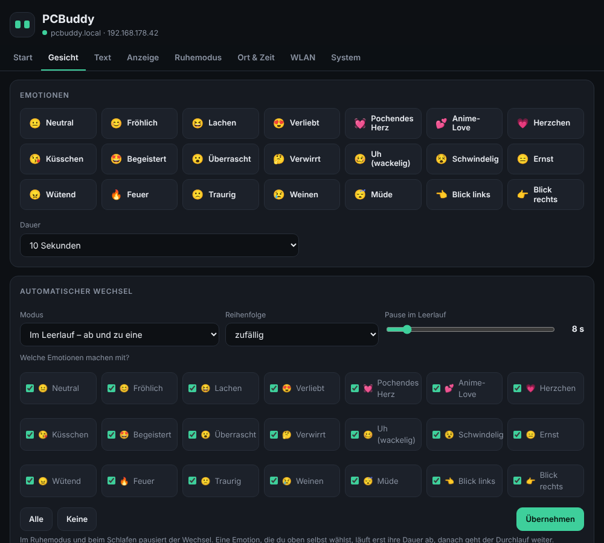

---

## Firmware-Update per WLAN

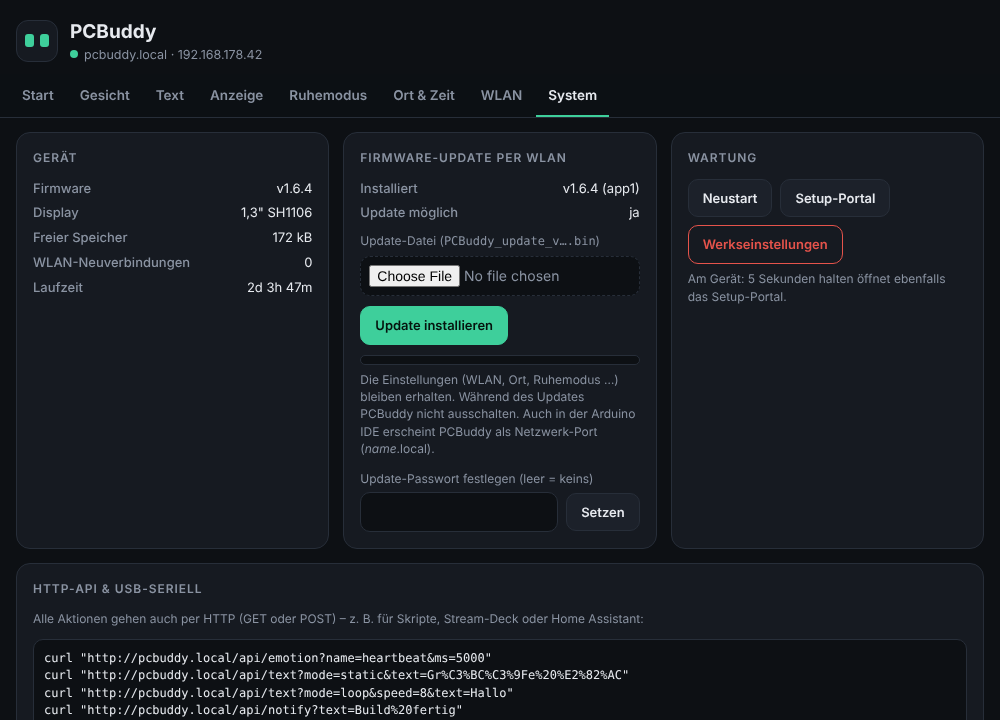

1. Die neueste **`PCBuddy_update_vX.Y.Z.bin`** aus den [**Releases**](../../releases) herunterladen
2. Dashboard → **System → Firmware-Update per WLAN** → Datei wählen → *Update installieren*
3. Das Display zeigt einen Fortschrittsbalken. PCBuddy startet neu, alle Einstellungen bleiben erhalten.

**Alternativ** erscheint PCBuddy in der Arduino IDE unter *Werkzeuge → Port* als Netzwerk-Port. Dann einfach *Hochladen*.

- PCBuddy prüft jede Datei vorher. Angenommen wird nur echte App-Firmware für den ESP32-C3; Komplett-, Bootloader- und
  Partitionsdateien werden abgelehnt, damit man ihn nicht versehentlich lahmlegt.
- Unter *System* lässt sich ein **Update-Passwort** festlegen. Es gilt für den Web-Upload und die Arduino IDE.
- Eine eigene Update-Datei erstellst du in der Arduino IDE mit *Sketch → Kompilierte Binärdatei exportieren*.
  Gebraucht wird `PCBuddy.ino.bin`, nicht `…merged.bin` oder `…bootloader.bin`.

---

## Steuerung per HTTP-API und USB

Jede Aktion geht auch per HTTP (GET oder POST). Die vollständige Liste steht in [**docs/API.md**](docs/API.md).

```bash
curl "http://pcbuddy.local/api/emotion?name=heartbeat&ms=5000"
curl "http://pcbuddy.local/api/notify?text=Build%20fertig"
curl "http://pcbuddy.local/api/text?mode=static&text=Bin%20gleich%20zur%C3%BCck"
curl "http://pcbuddy.local/api/quiet?state=on"
```

```powershell
Invoke-RestMethod "http://pcbuddy.local/api/notify?text=Kaffee%20ist%20fertig"
```

Über **USB-Seriell (115200 Baud)** gehen dieselben Befehle als Text, z. B. `emotion laugh`, `text Hallo`,
`quiet on`, `help`.

---

## Fehlersuche

| Problem | Lösung |
|---|---|
| `U8g2lib.h: No such file or directory` | Bibliothek **U8g2** im Bibliotheksverwalter installieren |
| „Sketch too big“ | Partition Scheme **Minimal SPIFFS (1.9MB APP with OTA…)** wählen |
| Update: „Partition Could Not be Found“ / „Kein Update-Bereich“ | PCBuddy läuft noch mit „Huge APP“. Einmal per USB mit **ESP32C3 Dev Module** + **Minimal SPIFFS** flashen. |
| Board verbindet sich nicht mit dem WLAN | Viele SuperMini-Boards haben eine schwache Antenne. `WIFI_TXPOWER_FIX 1` in `config.h` (Standard) hilft meist. Auch Abstand zum Router prüfen. |
| WLAN geht nach einiger Zeit verloren | Der WLAN-Wächter verbindet automatisch neu. Unter *System* siehst du die Anzahl der Neuverbindungen und den letzten Abbruchgrund. |
| `pcbuddy.local` geht nicht | Die IP-Adresse aus dem Display oder der Info-Folie verwenden (manche Android-Geräte können kein `.local`) |
| 1,3"-Display geht beim Piepen aus | Die Firmware stellt es automatisch wieder her. Dauerhaft besser: 100 Ω vor den Buzzer, Kondensator ans Display, Display an 5V. |
| Neigungssensor reagiert falsch | *Anzeige → Sensor-Test (live)* ansehen. SW-520D senkrecht einbauen, Empfindlichkeit anpassen. |
| Keine serielle Ausgabe | **USB CDC On Boot: Enabled** einstellen |

**WLAN-Wächter:** PCBuddy verbindet sich nach Abbrüchen selbst neu. Jeder 4. Versuch setzt den WLAN-Treiber zurück, eine
„tote“ Verbindung erkennt er per DNS-Test. Nach 20 Minuten ganz ohne Verbindung startet er neu.

---

## Projektaufbau

```
BUDDY/
├── PCBuddy/                 ← Arduino-Sketch (diesen Ordner in der IDE öffnen)
│   ├── PCBuddy.ino          Hauptprogramm
│   ├── config.h             Pins, Zeiten, Standardwerte
│   └── web_ui.h             Setup-Portal + Dashboard (HTML/CSS/JS, läuft offline auf dem Gerät)
├── docs/
│   ├── API.md               alle HTTP- und Seriell-Befehle
│   └── img/                 Bilder, Animationen, Schaltplan
├── CHANGELOG.md             Versionsgeschichte
└── LICENSE
```

Der Code ist in Abschnitte gegliedert (Einstellungen, Ton, Display, Gesicht, Wetter, Pac-Man-Uhr, Info-Folien, Text,
Gesten, Sensoren, WLAN, Update, Web-Server, Seriell). Jeder Abschnitt ist auf Deutsch kommentiert.

---

## Änderungen

Siehe [**CHANGELOG.md**](CHANGELOG.md). Aktuelle Version: **v1.6.4**.

## Lizenz

[MIT](LICENSE). Verwenden, ändern und weitergeben ausdrücklich erlaubt.

Wetterdaten von [Open-Meteo](https://open-meteo.com) (kostenlos, ohne API-Key). Display-Ansteuerung mit
[U8g2](https://github.com/olikraus/u8g2).
